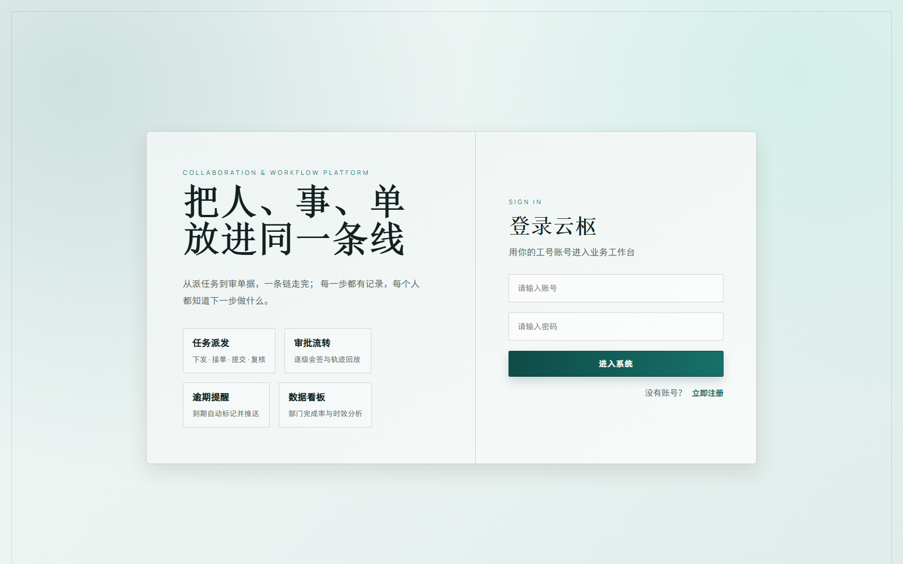
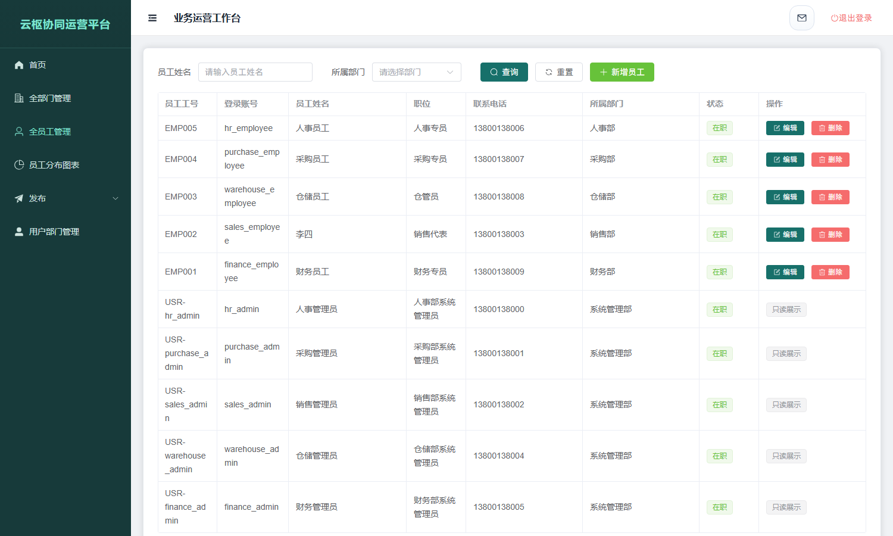
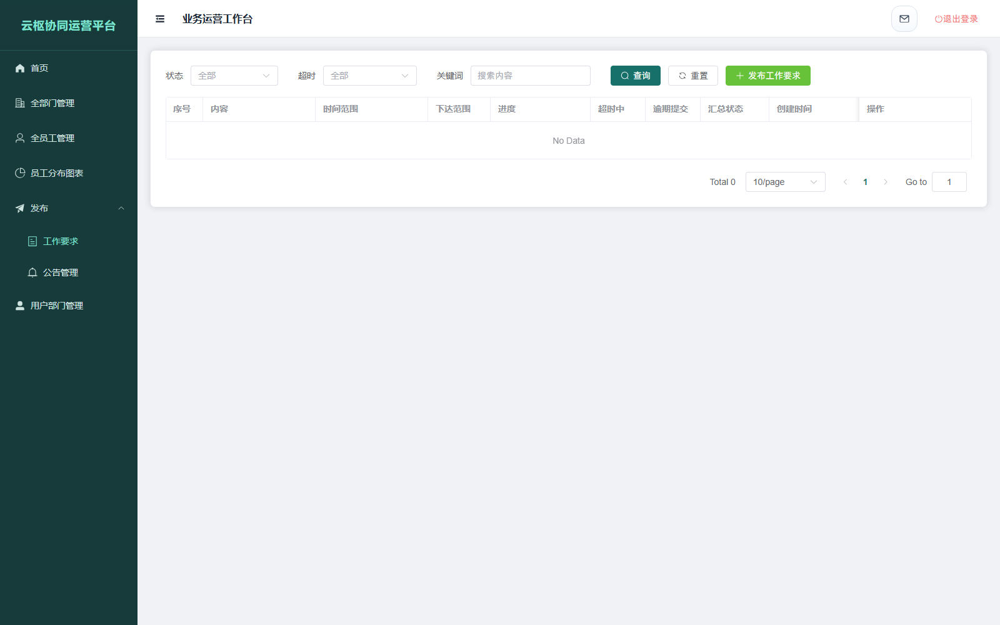
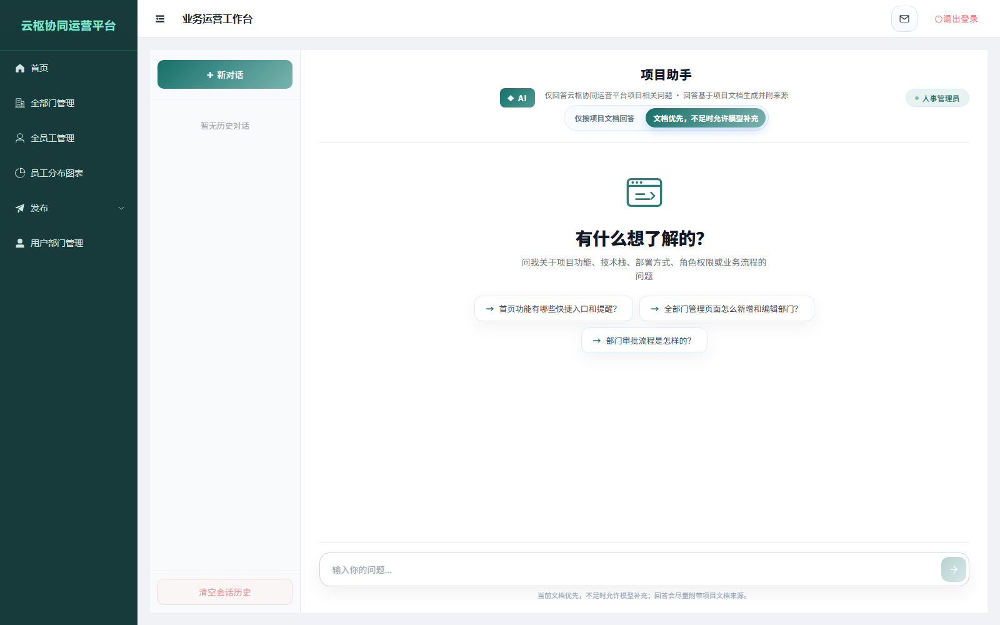
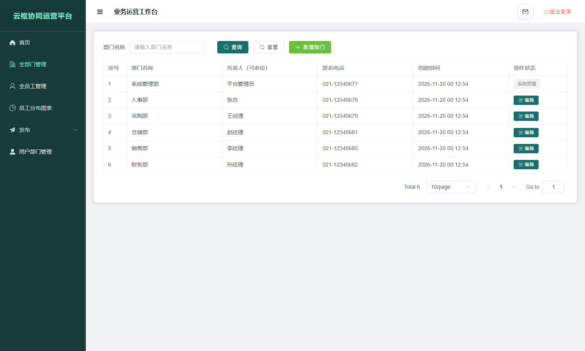

# 云枢 · 企业协同运营平台

面向多部门中小团队的一体化协同后台：把**进销退存业务**、**任务派发与审核闭环**、**历史单据审批作废**、**公告与站内消息**、**安全审计**和**项目知识问答助手**放在同一套系统里。

前后端分离，22 张表、147 个 REST 接口、33 个页面。



---

## 目录

- [为什么做这个](#为什么做这个)
- [功能地图](#功能地图)
- [业务闭环怎么走](#业务闭环怎么走)
- [技术栈](#技术栈)
- [快速开始](#快速开始)
- [默认账号](#默认账号)
- [项目结构](#项目结构)
- [关键实现](#关键实现)
- [已知边界](#已知边界)
- [接口文档](#接口文档)

---

## 为什么做这个

大多数进销存项目做到「能增删改查」就停了。真实的部门协同里，真正花时间的是另外三件事：

1. **任务下发之后没人跟** —— 谁接了、做到哪一步、超时了没有，全靠群里问。
2. **单据错了没法回头** —— 已经入账的采购单要作废，直接删数据会破坏账实一致。
3. **新人不熟悉系统** —— 每个角色能看哪些页面、走哪条流程，文档写了也没人看。

这套系统把这三件事都做成了可追溯的流程：任务有 6 个状态和超时扫描、单据作废必须经审批中心红冲留痕、每个角色配一份知识库文档并由 AI 助手按权限回答。

---

## 功能地图

### 组织与权限

| 模块 | 说明 |
|---|---|
| 部门管理 | 部门增删改查、负责人（支持多人）、部门编码与数据范围隔离 |
| 员工管理 | 员工档案、工号、职位、所属部门、在职状态 |
| 用户管理 | 登录账号、角色绑定、启用/禁用、密码重置 |
| 权限模型 | 角色（6 种）+ 部门编码双维度；前端路由级 `meta.roles` / `meta.deptCodes`，后端 Sa-Token 会话角色校验 |
| 超级管理员 | 平台级治理入口，越权访问走独立白名单 |

### 进销存业务

| 模块 | 说明 |
|---|---|
| 供应商 / 商品 | 基础资料维护，商品关联供应商与库存下限 |
| 商品进货 | 采购单录入、入库、库存增加 |
| 进货退货 | 退货单冲减库存，原单关联 |
| 商品销售 | 销售单录入、出库、毛利计算 |
| 销售退货 | 退货入库、原单关联 |
| 库存预警 | 按商品下限阈值列出待补货清单 |
| 销售分析 | 按日/按商品维度图表，毛利构成拆解 |



### 工作要求闭环（6 状态机）

派活 → 接单 → 提交 → 审核 → 通过 / 打回，全链路留痕：

```
待接单(0) ──接单──> 执行中(1) ──提交──> 待审核(2) ──审核通过──> 已完成(3)
                                          │
                                          └──审核不通过──> 已驳回(4) / 已打回(5) ──重新提交──> 待审核(2)
```

- **逾期自动标记**：`WorkRequirementOverdueScheduler` 每 10 分钟扫描一次（`cron = "0 */10 * * * ?"`），超过截止时间未提交的派单写入 `overdue_flag = 1`。
- **准时率统计**：提交时比对截止时间，写入 `submitted_on_time`（1 准时 / 0 逾期），部门维度汇总出准时率。
- **附件**：提交可带附件，单独存 `work_requirement_attachment`，下载走鉴权接口而非静态目录。
- **汇总状态**：一张任务下发给 N 个人时，按「全部完成 / 部分完成 / 无人接单」聚合出汇总状态。



### 历史单据审批（作废 / 红冲）

已入账的单据不能直接改，必须走审批：

```
待处理(1) ──受理──> 处理中(4) ──通过──> 已通过(2)
                        │
                        └──驳回──> 已驳回(3)
```

- 审批单记录申请人、目标单据类型与 ID、申请理由、审批意见。
- 通过后由业务侧执行红冲（生成反向流水）而不是物理删除，账实始终保持可对账。
- 状态流转使用 `UPDATE ... WHERE status = ?` 条件更新，避免并发重复受理。

### 公告与消息

- 公告按**受众角色**定向投放（全员 / 部门管理员 / 指定角色），列表按当前账号可见范围过滤。
- 站内消息中心：任务派发、审核结果、逾期提醒写入 `sys_message`，未读数在顶栏显示。

### 安全与审计

| 能力 | 实现 |
|---|---|
| 登录日志 | IP、UA、登录时间、成功/失败原因 |
| 操作日志 | AOP 切面记录请求路径、方法、参数摘要、耗时、操作人 |
| 错误日志 | 全局异常处理器落库，超管首页直接看 24 小时错误监控 |
| IP 策略 | 黑白名单、失败次数阈值、封禁时长，登录前置校验 |
| 防重复提交 | `@PreventDuplicateSubmit` 注解 + 切面，Redis SETNX 分布式窗口，Redis 不可用时降级为本地窗口 |
| 注册限流 | 按 IP 统计注册频率，`fixedDelay = 3600000` 定时清理过期计数 |

### 项目知识问答助手

不是通用聊天窗口，而是**只回答本系统相关问题**的检索增强助手：

- **知识库**：`AImd/` 下 8 份角色文档（超管 / 人事 / 采购 / 销售 / 仓储 / 财务 / 员工 / 索引）+ `projectmd/` 下 3 份项目文档，启动时按 Markdown 标题切块（单块上限 600 字符）。
- **权限过滤**：每份文档带 scope（public / admin / superadmin）与可见角色列表，检索前先按当前登录角色过滤，员工问不到管理员文档。
- **多模型 + 回退链**：支持通义千问 Plus、智谱 GLM-4-Flash、DeepSeek Chat、Kimi 8K，默认模型不可用时按 fallbackChain 依次降级。
- **预算与审计**：按角色配每日调用预算，超限返回提示而非报错；每次调用写 `ai_model_call_log`（模型、耗时、token、命中类型）。
- **命中类型可解释**：回答会标注 kb-hit（知识库命中）/ kb-miss-model（未命中转模型）/ general-model（通用问答），并附来源文档。
- **会话持久化**：`ai_conversation` + `ai_message` 两张表，历史会话可回看，凌晨 3 点清理过期会话。



---

## 业务闭环怎么走

举一条完整链路（采购视角）：

1. 人事在建部门时给采购部配好负责人和数据范围。
2. 采购管理员录入供应商 → 录商品 → 建采购单。
3. 采购单提交后库存增加；若录入有误，**不能删单**，走「作废审批」→ 审批通过后红冲出一条反向流水。
4. 库存低于商品下限时，预警中心自动列出待补货商品。
5. 主管在「工作要求」里下发「本周完成三家新供应商比价」，指定截止时间。
6. 采购员工接单 → 提交结果和附件 → 主管审核。
7. 若员工拖到截止时间之后才提交，超时扫描任务标记逾期，准时率统计里记为逾期提交。
8. 整个过程的登录、操作、审批动作都在审计日志里可回放。

---

## 技术栈

**后端**

| 组件 | 版本 | 用途 |
|---|---|---|
| Spring Boot | 3.3.5 | Web / Validation / AOP / Data Redis |
| JDK | 17 | 运行环境 |
| MyBatis-Plus | 3.5.5 | ORM、分页、逻辑删除、自动填充 |
| Sa-Token | 1.37.0 + sa-token-jwt | 登录态、会话角色、注解鉴权 |
| Hutool | 5.8.25 | 工具集 |
| Knife4j | 4.4.0 | OpenAPI3 文档 UI |
| MySQL | 8.0 | 主库 |
| Redis | 7.x | 防重复提交分布式锁（可选，缺失时自动降级） |
| Lombok | - | 简化实体 |

**前端**

| 组件 | 版本 |
|---|---|
| Vue | 3.4 |
| Vite | 5.2 |
| Element Plus | 2.7 |
| Pinia | 2.1 |
| Vue Router | 4.3 |
| Axios | 1.6 |
| ECharts | 5.5 |

---

## 快速开始

### 1. 环境准备

- JDK 17
- Maven 3.8+（仓库自带 `mvnw` / `mvnw.cmd`）
- Node.js 18+ 与 npm
- MySQL 8.0
- Redis（可选，不装则防重复提交降级为单机窗口）

### 2. 初始化数据库

```bash
mysql -u root -p -e "CREATE DATABASE warehouse_management DEFAULT CHARSET utf8mb4 COLLATE utf8mb4_general_ci;"
mysql -u root -p warehouse_management < db.sql
```

`db.sql` 会建好 22 张表并写入部门、角色账号、商品、采购/销售等演示数据。

### 3. 改配置

编辑 `back/src/main/resources/application.properties`：

```properties
spring.datasource.url=jdbc:mysql://localhost:3306/warehouse_management?useUnicode=true&characterEncoding=utf8&serverTimezone=Asia/Shanghai&useSSL=false&allowPublicKeyRetrieval=true
spring.datasource.username=你的账号
spring.datasource.password=你的密码
```

Redis 默认连 localhost:6379，可用 `spring.data.redis.host` / `port` 覆盖；不启动 Redis 也不影响主流程。

### 4. 启动

后端：

```bash
cd back
./mvnw spring-boot:run          # Windows: mvnw.cmd spring-boot:run
```

前端：

```bash
cd front
npm install
npm run dev
```

打开 http://localhost:5173 ，接口前缀 `/api`，文档 http://localhost:8080/api/doc.html 。

### 5. 想连 AI 助手一起跑

助手需要至少一个大模型 API Key。在 `back/assistant-llm.env` 写入其中任意一个：

```env
QWEN_API_KEY=sk-xxx
# 或 GLM_API_KEY= / KIMI_API_KEY= / DEEPSEEK_API_KEY=
```

不配 Key 时助手接口会走「知识库检索 + 提示配置模型」，不影响其余功能；只想跑主业务可以直接用 `start-no-ai.bat`。

---

## 默认账号

密码统一 `123456`，初始化后建议立即修改。

| 账号 | 角色 | 部门 | 能做什么 |
|---|---|---|---|
| `superadmin` | 超级管理员 | 系统管理部 | 全局审计、IP 策略、错误监控、越权白名单 |
| `hr_admin` | 人事管理员 | 人事部 | 部门 / 员工 / 用户管理、员工分布图表、发布公告与工作要求 |
| `purchase_admin` | 采购管理员 | 采购部 | 进货、进货退货、库存预警 |
| `sales_admin` | 销售管理员 | 销售部 | 销售、销售退货、库存预警、销售分析 |
| `warehouse_admin` | 仓储管理员 | 仓储部 | 库存与出入库相关单据 |
| `finance_admin` | 财务管理员 | 财务部 | 毛利与报表查看 |
| `*_employee` | 员工 | 各自部门 | 接任务、提交结果、看本部门公告 |



---

## 项目结构

```text
.
├─ back/                          # Spring Boot 后端
│  └─ src/main/java/org/example/back/
│     ├─ controller/              # 22 个控制器，147 个接口
│     ├─ service/                 # 业务实现（状态流转、逾期扫描、知识库检索）
│     ├─ mapper/                  # MyBatis-Plus Mapper
│     ├─ entity/                  # 22 张表对应实体
│     ├─ dto/ vo/                 # 出入参对象
│     ├─ common/
│     │  ├─ annotation/           # @PreventDuplicateSubmit
│     │  ├─ aspect/               # 防重复提交、操作日志切面
│     │  ├─ exception/            # 全局异常处理
│     │  └─ result/               # 统一响应包装
│     ├─ config/                  # Sa-Token、MyBatis-Plus、Knife4j、助手配置
│     ├─ scheduler/               # 工作要求逾期扫描
│     ├─ task/                    # AI 会话清理
│     └─ util/
├─ front/                         # Vue 3 前端
│  └─ src/
│     ├─ views/                   # 33 个页面
│     │  ├─ business/             # 进销存
│     │  └─ system/               # 系统管理、审计、助手
│     ├─ layout/                  # 侧栏 + 顶栏骨架
│     ├─ router/                  # 27 条路由 + 权限守卫
│     ├─ stores/                  # Pinia
│     ├─ utils/                   # 请求封装、鉴权存取、权限指令
│     └─ components/              # 助手悬浮球等
├─ AImd/                          # 8 份角色知识库文档（喂给 AI 助手）
├─ projectmd/                     # 3 份项目说明（前后端结构、项目总览）
├─ db.sql                         # 建表 + 演示数据
├─ start-no-ai.bat                # 一键起前后端（不含 AI）
├─ start-with-ai.bat              # 一键起，并引导填写模型 Key
└─ docs/screenshots/              # 截图
```

---

## 关键实现

### 统一响应与错误处理

所有接口返回 `{ code, msg, data }`，业务异常走 `BusinessException` 由全局处理器统一包装，同时把异常落到 `sys_error_log`，超管首页直接可视化。

### 防重复提交

```java
@PreventDuplicateSubmit(interval = 3000)
@PostMapping("/purchases")
public Result<Void> create(@RequestBody PurchaseDTO dto) { ... }
```

切面按「用户 + 接口 + 参数指纹」生成 key，先尝试 Redis `setIfAbsent(key, "1", intervalMs, MILLISECONDS)`；Redis 抛异常时回退到进程内 `ConcurrentHashMap` 窗口（上限 10000 条），保证单机可用性不依赖中间件。

### 逻辑删除

全表统一 `is_deleted` 字段，MyBatis-Plus 全局配置 `logic-delete-field=isDeleted`，业务代码不需要手写删除条件，查询自动过滤。

### 权限三层

1. **路由层**：`meta.roles` / `meta.deptCodes`，导航守卫拦截并跳 `/403`。
2. **接口层**：Sa-Token `StpInterface` 从会话取角色，缺失时回查数据库补齐。
3. **数据层**：按部门编码过滤查询范围，部门管理员看不到别的部门数据。

### 逾期扫描为什么不放在业务请求里

一开始是在列表接口里现算，后来改成定时任务落库：

- 列表接口只读 `overdue_flag`，响应稳定在毫秒级；
- 逾期状态可被消息中心、统计报表、审计复用；
- 扫描用 `end_time < now` 走索引，10 分钟一次对 22 张表的小系统开销可忽略。

---

## 已知边界

说清楚比藏着好：

- **单库单机**：没有分库分表，10 万级数据量下联合索引足够；再大需要按 `dept_id` 或时间分区。
- **审批是单级**：目前是「受理 → 通过/驳回」，没有多级会签和流程设计器。要做复杂审批建议接 Flowable。
- **AI 助手按关键词 + 标题切块检索**，不是向量检索。文档量小（约 100KB）时够用，文档上千份需要换 embedding + 向量库。
- **附件存本地磁盘**（`app.upload.base-path`），生产建议换对象存储。
- **前端没有单元测试**，后端也以接口联调为主；这是项目短板，不是特性。

---

## 接口文档

启动后端后访问：

- Knife4j UI：http://localhost:8080/api/doc.html
- OpenAPI JSON：http://localhost:8080/api/v3/api-docs

接口按控制器分组：认证、用户、部门、员工、供应商、商品、进货、进货退货、销售、销售退货、库存预警、销售分析、公告、消息、工作要求、审批、审计、安全策略、文件上传、首页聚合、AI 会话、项目助手。

---

## License

本项目采用 MIT License，详见 [LICENSE](LICENSE)。

第三方依赖：Spring Boot / MyBatis-Plus / Sa-Token / Element Plus 均为 Apache-2.0 或 MIT。
